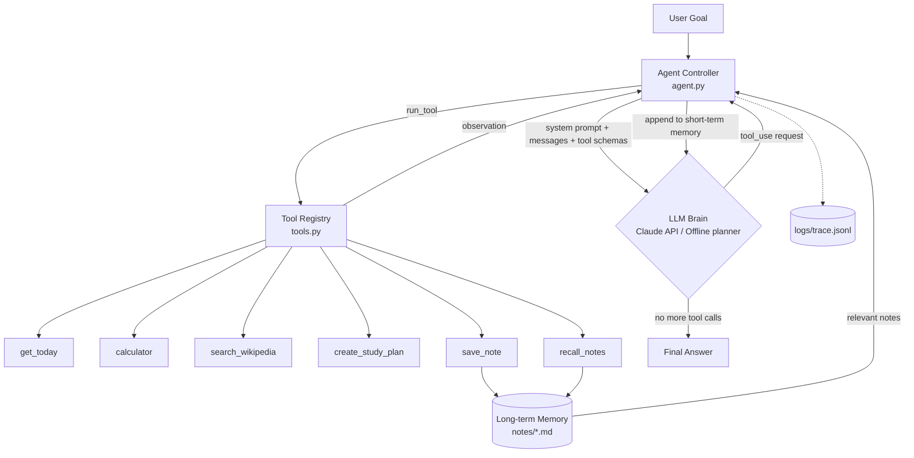
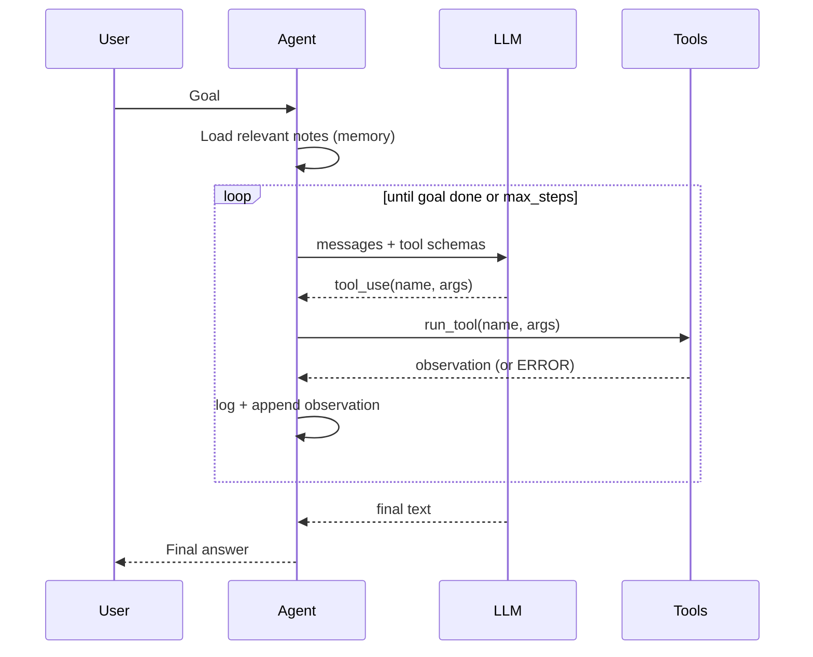

# StudyBuddy - An Agentic AI Study Planner

> Digital Assignment - Artificial Intelligence | Option (i): **Agentic Agent**
> Name: Saptarshi Pal | Reg. No: 23BME1188 | VIT

StudyBuddy is an **autonomous agent**. You give it a *goal* ("Help me study Neural Networks in 5 days");
it decides **on its own** which tools to call, observes the results, recovers from errors, remembers past
work, and stops when the goal is achieved.

## Why this is "agentic" (and not just a chatbot)

| Property | How StudyBuddy does it |
|---|---|
| **Goal-driven** | Takes a high-level goal, not a single question |
| **Planning** | The LLM decomposes the goal into steps (date -> research -> plan -> save) |
| **Tool use** | 6 tools with JSON schemas; the model chooses which to call and with what arguments |
| **Observation loop** | Tool results are fed back to the model (ReAct: Reason -> Act -> Observe) |
| **Memory** | Short-term = message history; Long-term = markdown notes recalled in future runs |
| **Error recovery** | Tool failures return `ERROR:` text; the agent adapts instead of crashing |
| **Safety / control** | Step limit, safe calculator (AST, no `eval`), full trace log |
| **Transparency** | Every step logged to `logs/trace.jsonl` |

## Architecture / Schema



### Agent loop (sequence)



## Project structure

```
study-agent/
├── main.py            # CLI (single goal or interactive)
├── agent.py           # agent loop: plan -> act -> observe
├── llm.py             # ClaudeLLM (real) + OfflineLLM (no API key needed)
├── tools.py           # 6 tools + JSON schemas + safe dispatcher
├── memory.py          # long-term memory retrieval
├── tests/test_agent.py
├── requirements.txt
└── README.md
```

## Setup & run

```bash
git clone <your-repo-url> && cd study-agent
pip install -r requirements.txt

# Option A - real LLM reasoning (recommended for the demo)
export ANTHROPIC_API_KEY="sk-ant-..."      # Windows PowerShell: $env:ANTHROPIC_API_KEY="sk-ant-..."
python main.py "Help me study Neural Networks in 5 days"

# Option B - offline, no key needed
python main.py --offline "Help me study Search Algorithms in 3 days"

# Interactive mode
python main.py

# Tests
pytest -q
```

### Sample output (offline mode)

```
[step 1] get_today({}) -> '2026-10-11'
[step 2] search_wikipedia({'query': 'Neural Networks'}) -> '...'
[step 3] create_study_plan({'topic': 'Neural Networks', 'days': 4}) -> 'Day 1 ...'
[step 4] save_note({'title': 'Neural Networks study plan', ...}) -> 'Saved note to notes/...'

FINAL ANSWER:
Day 1 (2026-10-11): Neural Networks - Core concepts & definitions
Day 2 (2026-10-12): Neural Networks - Worked examples & algorithms
Day 3 (2026-10-13): Neural Networks - Practice problems
Day 4 (2026-10-14): Neural Networks - Mock test + final revision
```

## Tools

| Tool | Purpose |
|---|---|
| `get_today` | Current date so plans have real dates |
| `calculator` | Safe arithmetic via AST (no `eval`) |
| `search_wikipedia` | Research a topic through Wikipedia's REST API |
| `create_study_plan` | Day-by-day plan with revision + mock test |
| `save_note` | Write to long-term memory |
| `recall_notes` | Retrieve past notes |

## Possible extensions

Spaced-repetition reminders, a web UI (Streamlit), PDF syllabus ingestion, a vector-store memory, multi-agent (researcher + planner + critic).

## License

MIT
